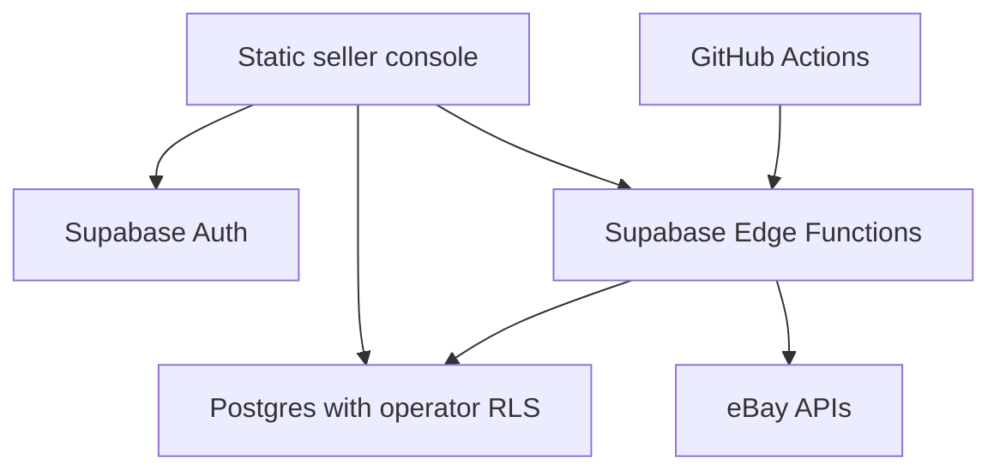

# Jonny Store Console

A private eBay seller workspace with a futuristic dark/light interface, Supabase Auth and Edge Functions, and GitHub Actions for deployment and scheduled sync. Active listings, buyer offers, and listing views take center stage.

**This is an initial implementation, not a connected AutoDS replacement.** The repository began with only a README. No Supabase project, eBay account, credentials, or repository settings were available to configure during development. Live operation requires the setup below and sandbox validation. With no public Supabase configuration, the website opens a clearly labeled, interactive **demo** with sample data.

## Included

| Area | Implemented behavior |
| --- | --- |
| Overview | Active listings, available units, daily views, active buyer offers, paid USD order revenue, estimated contribution profit, low-stock alerts, approval queue, activity |
| Listings | Search, status/stock filters, sorting, CSV export, per-listing 30-day view snapshots, watcher counts; queue price/stock changes |
| Offers | Sync active **buyer Best Offers**, filter expired offers, open eBay Seller Hub to respond; Inventory API listing offers are kept distinct |
| Orders | Sync orders created in the last 30 days, paid/unfulfilled status, queue full-order tracking updates |
| Products | Amazon/AliExpress/wholesale/owned-inventory records, CSV import, product drafts, costs, supplier links, item specifics, eBay publication fields |
| Publication | Create Inventory API inventory item + listing offer + publish via an approved action; new-condition, single-SKU, USD / EBAY_US only |
| Automation | Scheduled sync; price/stock proposals using recently verified product data; execute approved publication/revision/tracking actions |
| Controls | Operator allowlist, RLS, server-only tokens, expiring single-use OAuth state, default approvals, production write gate, idempotency and atomic action claims, audit log |
| Appearance | Responsive desktop/mobile layout, persistent light/dark theme, accessible dialogs and form labels |

**Not connected in this version:** automatic supplier feeds, Amazon/AliExpress purchasing, supplier shipment polling, demand/popularity APIs, and responding to buyer offers inside the console. Fulfill through an eligible supplier or your own stock, then enter tracking. No supplier scrape, fabricated popularity score, or undocumented purchasing endpoint is used. Existing listings managed through other Inventory API applications need their proper offer mappings before revision; unsupported listings are rejected for manual handling.

## Run locally

Node 24 is used in CI.

```sh
npm ci
npm run dev
```

The demo works without credentials. For the live login, copy `.env.example` to `.env.local` and set only the Supabase URL and **publishable** (or legacy anon) key. Never put a service-role key, secret key, access token, or eBay client secret in a `VITE_*` variable. The build validates frontend configuration and rejects privileged keys.

```sh
npm run build
npm test
npm run test:dom
npm run check:edge
npx playwright install --with-deps chromium --only-shell
npm run test:ui
```

## Deploy

Follow [the setup guide](docs/SETUP.md) for the exact GitHub variables, secrets, operator invitation, eBay OAuth redirect, database migration, and function deployment.

1. Deploy the database migration and the three Edge Functions.
2. Create your Supabase Auth user and allowlist **only that UUID**. Disable public signup.
3. Configure the frontend public variables and deploy the static build.
4. After developer approval, authorize eBay **sandbox**, sync, and validate the complete action lifecycle.
5. Enable scheduled sync only after a manual sync succeeds. Keep action approval enabled while testing.
6. Switch to production credentials and reconnect when ready. Production writes remain disabled unless the backend secret explicitly enables them.

The Pages and sync workflows are opt-in. GitHub Pages has [commercial-use restrictions](https://docs.github.com/en/pages/getting-started-with-github-pages/github-pages-limits). Check whether your seller-console use is permitted before enabling it. The same static `dist/` output can be hosted elsewhere without changing the backend. There is no buyer checkout or payment collection in this app; that does not by itself establish compliance with Pages terms.

## Architecture



The browser receives only public configuration and the signed-in operator's session. It can read its RLS-protected seller tables; all mutations go through authenticated Edge Functions. Tokens, OAuth state, and job locks have no browser grants. Edge Functions receive the service-role key from their Supabase runtime automatically: **you do not need to paste that key into chat or put it in GitHub.**

## Boundaries and estimates

- eBay permits eligible wholesale dropshipping / fulfillment of inventory you own; buying from another retailer or marketplace after an eBay sale and having it ship directly to the buyer is not an eligible sourcing model. See [eBay's policy](https://export.ebay.com/en/services-tools/shipping/shipping-tips-and-best-practice/drop-shipping/). Amazon records can be research or already-owned stock. AliExpress records do not imply an established wholesale agreement.
- Stock and costs must be manually verified within **six hours**. Once an approved supplier API exists, add a server-side connector to update this data with trustworthy timestamps. The scheduler cannot discover new prices or stock from product URLs.
- Automatic price targets use `(cost + unit shipping + fixed fee) / (1 - fee rate - desired margin)`, rounded upward. Margin is a percentage of selling price. Moves greater than 25% require review even if normal approvals are disabled.
- Profit is an **estimated contribution**, using paid USD order totals minus known product/shipping costs and configured fee estimates. It excludes returns, tax adjustments, actual fee reconciliation, and overhead. Orders with unknown costs are excluded and coverage is shown. Non-USD orders remain visible but are excluded from USD totals.
- Daily store traffic and per-listing 30-day snapshots are stored separately. Repeated syncs upsert instead of adding duplicate views. Traffic generally lags; sandbox or missing scopes may not provide Analytics data.
- Sync is designed for a small single-seller store. Reads are paginated; bounded time/page limits fail visibly. Supabase plan execution limits and eBay rate limits still apply. Large catalogs need eBay feeds and durable background jobs.
- Actions older than 24 hours fail closed. An ambiguous external write becomes `needs_review`; verify eBay state and reconcile before creating another action. There is no automatic retry of an uncertain publish or shipment.
- GitHub scheduled Actions are best-effort and can be delayed or disabled after repository inactivity. Check both workflow runs and the in-app activity log. They are not a guaranteed real-time inventory service.

## API references

- [eBay authorization](https://developer.ebay.com/develop/guides/sell/authorization)
- [Trading GetMyeBaySelling](https://developer.ebay.com/devzone/xml/docs/reference/ebay/getmyebayselling.html) and [GetBestOffers](https://developer.ebay.com/devzone/XML/docs/Reference/eBay/GetBestOffers.html)
- [Traffic report metrics](https://www.developer.ebay.com/api-docs/sell/static/performance/traffic-report.html)
- [Inventory publishing requirements](https://www.developer.ebay.com/api-docs/sell/static/inventory/publishing-offers.html)
- [Supabase function authentication](https://supabase.com/docs/guides/functions/auth) and [deployment](https://supabase.com/docs/guides/functions/deploy)

See [docs/TESTING.md](docs/TESTING.md) for verification and the live sandbox checklist.
